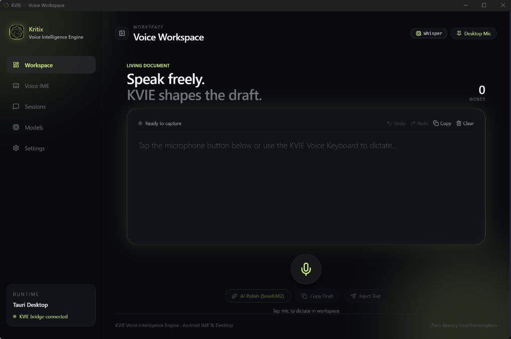
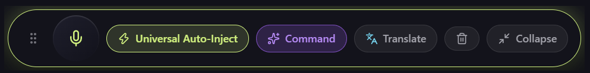
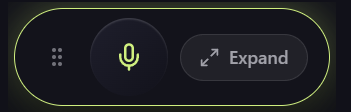

# Kritix Voice Intelligence Engine (KVIE)

KVIE is a voice dictation and text-editing app for desktop and Android. It combines streaming speech recognition, text cleanup, voice commands, and text entry through a desktop floating mic or an Android keyboard.

KVIE is under active development. Recognition accuracy, latency, and text injection behavior depend on the speech model, microphone, operating system, and target app. This README describes the current implementation; it does not claim feature parity with another product or universal compatibility with every text field.

<p align="center">
  
</p>

## Current capabilities

### Desktop (Windows and macOS)

- Streaming dictation through the local Python FastAPI service and Faster-Whisper.
- Downloadable speech models managed by the app; inference uses the local model files.
- A Tauri/Rust desktop shell, floating microphone window, and platform-specific hotkey and text-injection code.
- Transcript cleanup with grammar rules, a custom dictionary, and voice snippets.
- Optional text editing through a local Ollama service. If Ollama is unavailable or times out, the app falls back to its non-LLM cleanup path.
- Voice commands and translation features in the desktop client.

Text injection depends on operating-system permissions and the target app's input behavior. Test the apps you plan to use; support is not guaranteed for every application or input field.

### Android

- A native Kotlin keyboard and floating microphone experience.
- Speech recognition through Android's `SpeechRecognizer`. Whether recognition stays on-device or uses a network service depends on the recognizer installed and selected on the device.
- Text cleanup varies by Android build. The Android source includes local refinement components; the standalone keyboard module also contains an optional HTTP refinement client with a placeholder URL that must be configured before it can use a server.

## Processing and privacy

On desktop, microphone audio is sent to KVIE's local Python service and transcribed with a downloaded local Faster-Whisper model. Downloading or updating a model requires a network connection. Desktop LLM cleanup uses the configured Ollama endpoint, which defaults to localhost.

Android speech recognition is provided by Android's selected speech-recognition service; KVIE cannot guarantee that provider processes audio offline. Check the device provider's settings and privacy policy if offline processing is required.

## Screenshots

<p align="center">
  
</p>

<p align="center">
  
  <br />
  
</p>

## Architecture

| Platform | Main components | Speech and text processing |
| --- | --- | --- |
| Desktop | React + TypeScript UI, Tauri v2 + Rust, Python FastAPI service | Faster-Whisper local transcription; TypeScript cleanup; optional local Ollama editing |
| Android | Kotlin input method and floating-mic services | Android `SpeechRecognizer`; cleanup/refinement depends on the Android build and provider |

Desktop flow:

```text
Microphone → Python streaming service → Faster-Whisper → transcript events
           → text cleanup / optional Ollama → Tauri/Rust text injection
```

## Requirements

- Node.js 18+ and npm
- Python 3.12 recommended
- Rust stable toolchain and Cargo
- For Android development: Android Studio, Android SDK/NDK, and a compatible JDK

## Desktop development

Clone the repository and install the JavaScript and Python dependencies:

```bash
git clone https://github.com/Kritix-AI/KVIE.git
cd KVIE
npm ci
python -m venv .venv
```

Activate the virtual environment, then install Python dependencies:

```bash
# Windows PowerShell
.venv\Scripts\Activate.ps1

# macOS / Linux
source .venv/bin/activate

python -m pip install -r requirements.txt
```

Run the desktop development app:

```bash
npm run tauri:dev
```

Tauri starts the local Python service as part of desktop startup. To run the service separately, use:

```bash
npm run kvie:service
```

Speech models are selected/downloaded through the app's model manager. Ollama is optional; install and start it locally if you want LLM-based cleanup.

Build desktop installers with:

```bash
npm run tauri:build:win
npm run tauri:build:mac
```

Run only the command for your target operating system.

## Android development

Install Android Studio and configure the Android SDK/NDK first. Then initialize and launch the Android development workflow:

```bash
npm run android:init
npm run android:dev
```

Build an APK with:

```bash
npm run android:build
```

After installation, enable the KVIE keyboard in Android's keyboard settings and grant microphone permission when prompted. Android accessibility features, where used, require a separate explicit enablement in system settings.

## Checks

These are the repository's main CI checks:

```bash
npx tsc -p tsconfig.json --noEmit
npm run build
python -m pytest tests -q
cargo check --manifest-path src-tauri/Cargo.toml
```

## KVIE investigation agents

Custom Antigravity agent definitions and shared rules live in `.agents/`. Start with `@kvie-lead`; it coordinates read-only investigators, assigns a scoped finding to `kvie-fixer`, and asks `kvie-verifier` to review the change independently. Investigators should not edit files, and hypotheses must be labeled separately from confirmed findings.

## License

KVIE is distributed under the MIT License. See [LICENSE](LICENSE).
