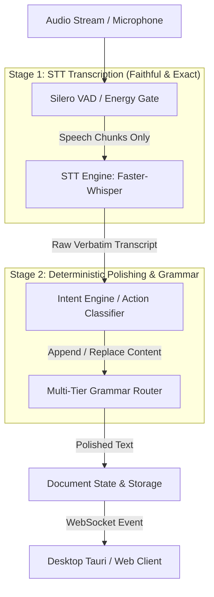
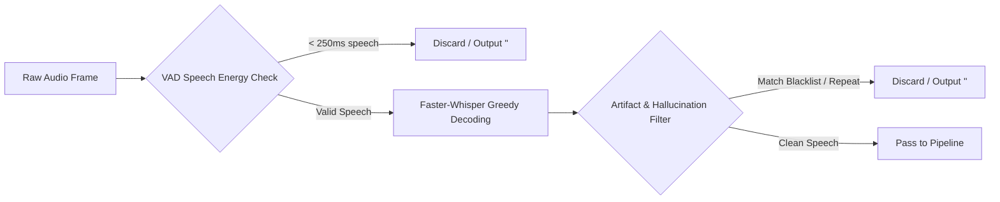
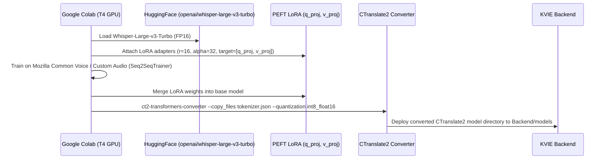
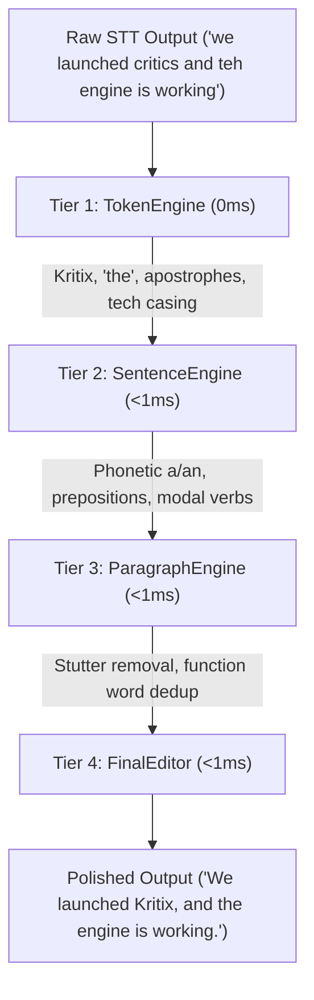

# KVIE Backend Speech Pipeline & Grammar Polishing Research Report

## 1. System Pipeline: Separation of STT and Text Polishing

The KVIE dictation pipeline strictly separates **acoustic transcription** from **semantic polishing**:



### Core Responsibilities
1. **Stage 1: Acoustic Transcription (STT)**
   - **Goal**: Output the *exact, unvarnished words* uttered by the speaker.
   - **Rule**: STT must never guess, invent, or add context beyond audio signals. On silence or room noise, STT must output empty string `""`.
2. **Stage 2: Text Polishing (Grammar Router & Intent)**
   - **Goal**: Clean up spoken disfluencies (hesitations, false starts, slips of the tongue), fix acoustic homophones, apply standard capitalization, spacing, and English grammar rules.
   - **Rule**: Obey **Speaker Intent Integrity** (`.agents/rules/kvie-engineering.md`). Never rephrase or alter what the speaker meant.

---

## 2. STT Hallucination: Root Causes & Solutions

Investigations conducted by the `voice-quality-investigator` identified four specific mechanisms in `Backend/voice/STT.py`, `Backend/voice/StreamingSTT.py`, and `Backend/kvie/service.py` causing Whisper to hallucinate:

### Root Causes Analysis

| # | Mechanism | File Location | Observed Failure |
|---|---|---|---|
| **1** | **Prompt Injection / Leakage** | `Backend/voice/STT.py:458-463` | `_HOTWORD_PROMPT` contains complete conversational sentences (`"Aaj ka kya plan hai, Main bilkul thik hu, Khaana kha liya kya..."`). When fed silence or quiet noise, Whisper's autoregressive decoder repeats these prompt sentences verbatim as if they were spoken. |
| **2** | **Suboptimal Faster-Whisper Parameters** | `Backend/voice/STT.py:644-656`<br>`Backend/kvie/service.py:637` | • `temperature` is unset (defaults to fallback range `[0.0, 0.2, 0.4, 0.6, 0.8, 1.0]`), generating hallucinations under uncertainty.<br>• `without_timestamps=True` disables timestamp generation, breaking Whisper's internal `hallucination_silence_threshold`.<br>• `compression_ratio_threshold=999.0` explicitly disables gzip compression loop detection.<br>• `repetition_penalty` is missing (defaults to 1.0 unpenalized). |
| **3** | **Phase 1 Silence Bypass** | `Backend/voice/StreamingSTT.py:260-268` | StreamingSTT Phase 1 transcribes full 2000ms rolling windows unconditionally, even when audio contains zero speech, feeding background room noise directly into Whisper. |
| **4** | **YouTube / Web Training Artifacts** | Missing in `Backend/voice/STT.py` | Silence or low-SNR audio triggers Whisper's web training artifacts (`"Thank you for watching"`, `"Please subscribe"`, `"Subtitles by..."`). |

---

### Surgical Anti-Hallucination Blueprint



#### Recommended Faster-Whisper Parameter Configuration
```python
# Optimal anti-hallucination inference configuration
segments, info = model.transcribe(
    audio,
    beam_size=1,                         # Greedy decoding for maximum speed and fidelity
    temperature=0.0,                     # Strictly greedy; disables hallucination escalation
    repetition_penalty=1.15,             # Suppresses looped repetition of words/phrases
    compression_ratio_threshold=2.4,     # Rejects runaway repetitive loops
    log_prob_threshold=-1.0,             # Discards low-confidence transcriptions
    no_speech_threshold=0.6,             # High sensitivity silence filter
    condition_on_previous_text=False,    # Prevents hallucinations carrying forward across chunks
    vad_filter=True,                     # Native Silero VAD gating before acoustic decoding
    vad_parameters=dict(
        min_silence_duration_ms=500,
        speech_pad_ms=200,
    ),
    without_timestamps=False,            # Retains timestamp boundaries
    hallucination_silence_threshold=1.5  # Skips segments with >1.5s silence gap
)
```

#### Hotword Prompt Sanitization
Replace full conversational sentences in `_HOTWORD_PROMPT` with a clean, comma-separated domain terminology string:
```python
# Before (Vulnerable to decoder completion):
# "Aaj ka kya plan hai, Main bilkul thik hu, Khaana kha liya kya..."

# After (Clean vocabulary biasing without sentence priming):
_HOTWORD_PROMPT = "KVIE, Kritix, Python, TypeScript, React, Vite, FastAPI, WebSocket, API, GitHub"
```

#### Subtitle Artifact Blacklist Filter
```python
HALLUCINATION_BLACKLIST_REGEX = re.compile(
    r"(?i)^(\s*(thank you for watching|thanks for watching|please subscribe|"
    r"subtitles by|translated by|like and subscribe|watching!|see you next time|"
    r"you|bye|hello\?|amara\.org|transcript by|captioning by)\s*[.?!]*\s*)+$"
)
```

---

## 3. STT Upgrade & Fine-Tuning Roadmap

### Comparison of STT Upgrade Options

| Metric / Feature | Option 1: Whisper-Large-v3-Turbo (CTranslate2) | Option 2: LoRA Fine-Tuned Whisper-Large-v3-Turbo | Option 3: NVIDIA NeMo Parakeet TDT / Moonshine |
|---|---|---|---|
| **Architecture** | Transformer Encoder-Decoder (809M params, 4 decoder layers) | LoRA Adapter (Rank 16, ~8M trainable params on v3-Turbo) | FastConformer-Transducer (RNN-T/TDT) or Moonshine |
| **Acoustic Fidelity** | Superior clarity on English & Hinglish; 4x faster than v3 | Domain-customized vocabulary & accent calibration | Near-zero hallucination (Transducer has no language decoder) |
| **Inference Speed** | ~150ms per 2s chunk (GPU) / ~450ms (CPU INT8) | ~160ms per 2s chunk | ~80ms per 2s chunk (GPU only) |
| **Colab Training Effort** | Zero (Pre-trained drop-in) | ~1-2 hours on free Google Colab T4 GPU | Extensive NeMo pipeline setup |
| **CTranslate2 Compatibility** | Native (`Systran/faster-whisper-large-v3-turbo`) | Converted via `ct2-transformers-converter` | Requires ONNX / TensorRT-LLM |
| **Recommendation** | **Immediate Primary Upgrade (Phase 1)** | **Custom Fine-Tuning Upgrade (Phase 2)** | Alternative for strict non-generative ASR |

---

### Colab LoRA Fine-Tuning Workflow

When domain adaptation or accent customization is needed (e.g. Indian English / Hinglish speech recognition):



---

## 4. Text Polishing: Multi-Tier Grammar Router Architecture

Investigations by the `backend-investigator` revealed that `Backend/kvie/grammar_router.py` was disconnected from the WebSocket transcription pipeline, `/api/autoedit` failed with HTTP 503 when Ollama was offline, and existing regex rules contained severe phonetic and formatting defects.

### The 4-Tier Pipeline Architecture



### Comprehensive Rules Catalog Across the 4 Tiers

#### Tier 1: `TokenEngine` (Lexical & Typographical Correction)
- **Spoken Typo Mapping (200+ common STT transcription slips)**:
  - `"teh"` ➔ `"the"`, `"becuase"` ➔ `"because"`, `"alot"` ➔ `"a lot"`, `"occurance"` ➔ `"occurrence"`, `"maintainance"` ➔ `"maintenance"`, `"seperate"` ➔ `"separate"`, `"truely"` ➔ `"truly"`, `"untill"` ➔ `"until"`.
- **Phonetic Brand Casing**:
  - `"critics"` / `"critix"` ➔ `"Kritix"`, `"github"` ➔ `"GitHub"`, `"linkedin"` ➔ `"LinkedIn"`, `"youtube"` ➔ `"YouTube"`, `"chatgpt"` ➔ `"ChatGPT"`, `"vscode"` ➔ `"VS Code"`.
- **Apostrophe Restoration**:
  - Restores missing contractions from fast speech: `\b(cant|dont|wont|didnt|isnt|arent|wouldnt|couldnt|shouldnt|hasnt|havent)\b` ➔ `can't`, `don't`, `won't`, `didn't`, `isn't`, `aren't`, `wouldn't`, `couldn't`, `shouldn't`, `hasn't`, `haven't`.
- **Contextual Homophones**:
  - Guarded replacement for `their/there/they're`, `your/you're`, `its/it's` based on subsequent token parts of speech.

#### Tier 2: `SentenceEngine` (Syntax & Phonetic Grammar)
- **Phonetic Article Resolution (`a` vs `an`)**:
  - **The Defect in current backend**: `re.sub(r"\b(a)\s+([aeiou][a-z]+)\b", r"an \2")` broke phonetic exceptions, turning `"a university"` into `"an university"` and `"an hour"` into `"a hour"`.
  - **The Solution**: Explicit phoneme exception tables:
    - `A_EXCEPTIONS`: `"university"`, `"universal"`, `"user"`, `"unique"`, `"european"`, `"one"`, `"useful"`, `"euphemism"`, `"ubiquitous"`.
    - `AN_EXCEPTIONS`: `"hour"`, `"hourly"`, `"honor"`, `"honest"`, `"heir"`, `"herb"` (US).
- **Spoken Modal Verb Contraction Corrections**:
  - `"could of"` ➔ `"could have"`
  - `"would of"` ➔ `"would have"`
  - `"should of"` ➔ `"should have"`
  - `"might of"` ➔ `"might have"`
  - `"suppose to"` ➔ `"supposed to"`
  - `"use to"` ➔ `"used to"`
- **Preposition Collocation Fixes**:
  - `"interested on"` ➔ `"interested in"`
  - `"congratulations for"` ➔ `"congratulations on"`
  - `"discuss about"` ➔ `"discuss"`
  - `"explain about"` ➔ `"explain"`
  - `"married with"` ➔ `"married to"`
  - `"depend of"` ➔ `"depend on"`
  - `"rely into"` ➔ `"rely on"`
- **Formatting Preservation**:
  - Use regex that preserves newlines (`\n`) and code indentations instead of collapsing sentences via `" ".join()`.

#### Tier 3: `ParagraphEngine` (Disfluency & Discourse Polishing)
- **Safe Word Deduplication (Stutters)**:
  - **The Defect in current backend**: `\b(\w+)\s+\1\b` stripped valid repetitions like `"had had"`, `"that that"`, `"Bora Bora"`, `"Duran Duran"`.
  - **The Solution**: Restrict deduplication to function words:
    `\b(the|a|an|and|or|but|is|are|was|were|be|been|to|of|in|on|at|for|with|from|by|it|this)\s+\1\b` ➔ `\1`.
- **Verbal Hesitation Sound Stripping**:
  - Strip acoustic vocal stalls: `\b(um+|uh+|aah+|umm+|uhh+|er+)\b` ➔ `""`.
- **False-Start Cleanup**:
  - Strip spoken corrections: `\b(\w+)\s+(\.\.\.|—|-)\s+(actually|i mean|no|wait)\s+` ➔ `""`.

#### Tier 4: `FinalEditor` (Typography & Punctuation Guardrails)
- **Technical Symbol & URL Protection**:
  - Guard punctuation spacing to prevent mangling technical strings (`"node.js"` ➔ `"node. js"` or `"test.py"` ➔ `"test. py"`).
- **Whitespace Sanitization**:
  - Collapse horizontal whitespace (`[^\S\n]+` ➔ `" "`) while preserving multiline formatting.
- **Controlled Punctuation**:
  - Capitalize first word of sentences; avoid forcing trailing periods on incomplete fragments or single-word commands.

---

## 5. Pipeline Integration & System Resilience

### 1. Backend Pipeline Connection (`Backend/kvie/service.py`)
In `session.process_transcript`:
```python
# Apply GrammarRouter after IntentEngine classification to keep intent keywords intact
decision = self.intent_engine.classify(text, context)
if decision.action in ("append", "replace", "insert") and decision.content:
    polished_content = GrammarRouter.route(decision.content)
    grammar_changed = (polished_content != decision.content)
    # Apply polished content to DocumentState
```

### 2. Stream Safety (Rule 2 Compliance)
- **Strict Prohibition**: Never run `GrammarRouter` on partial streaming deltas.
- **Reason**: Streaming word-overlap alignment (`stripCommittedOverlap` / `_merge_rolling_text`) relies on verbatim acoustic prefixes. Modifying tokens mid-stream breaks overlap detection and causes stutter/repetition loops.

### 3. Resilient `/api/autoedit` Fallback
When local Ollama is offline or uninstalled, `/api/autoedit` must never return HTTP 503. Instead, it falls back seamlessly to `GrammarRouter.route()` with status 200:
```python
try:
    refined = await generate_ollama_autoedit(...)
    model_used = "qwen2.5:1.5b"
except Exception as exc:
    logger.warning("Local Ollama auto-edit offline; using GrammarRouter fallback: %s", exc)
    refined = GrammarRouter.route(text)
    model_used = "grammar-router-fallback"
return JSONResponse({"refined_text": refined, "model": model_used})
```

---

## 6. Implementation Checklist (For Future Execution)

- [ ] **STT Anti-Hallucination**:
  - [ ] Replace `_HOTWORD_PROMPT` sentences in `STT.py` with vocabulary words.
  - [ ] Pass `temperature=0.0`, `repetition_penalty=1.15`, `compression_ratio_threshold=2.4`, `vad_filter=True` in `_transcribe_faster_whisper`.
  - [ ] Add VAD energy gate check in `StreamingSTT.py` Phase 1.
  - [ ] Add regex subtitle hallucination filter in `STT.correct_text()`.
- [ ] **STT Upgrade**:
  - [ ] Configure `Systran/faster-whisper-large-v3-turbo` as default model target.
  - [ ] Prepare Colab LoRA notebook for custom domain fine-tuning.
- [ ] **Grammar Engine**:
  - [ ] Port `A_EXCEPTIONS` and `AN_EXCEPTIONS` phonetic logic to `Backend/kvie/grammar_router.py`.
  - [ ] Expand `TokenEngine` with 200+ typos, brand casings, and apostrophe rules.
  - [ ] Fix function-word-only deduplication in `ParagraphEngine`.
  - [ ] Guard technical symbols and preserve newlines in `FinalEditor`.
  - [ ] Connect `GrammarRouter` into `KVIESession.process_transcript`.
  - [ ] Add graceful fallback in `/api/autoedit`.
- [ ] **Verification**:
  - [ ] Create `tests/test_grammar_router.py`.
  - [ ] Verify with `pytest tests/test_kvie_service.py` and `npm run build`.
